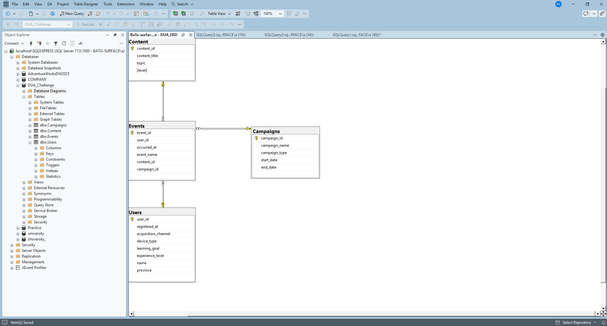

# DUA Edu – Data Analyst Intern Challenge

**Câu hỏi:** How can DUA Edu improve User Activation & Retention?
**Tác giả:** Đinh Nguyễn Tùng Bách
**Công cụ:** SQL Server · Google Sheets · Looker Studio

📊 **Dashboard:** [DUA Edu – User Activation & Retention Dashboard](https://datastudio.google.com/reporting/70cc93c1-4bac-47ab-9e6a-9b30d3510d54)

---

## Dữ liệu

Bộ dữ liệu giả lập do DUA Edu cung cấp cho vòng thử thách (không đưa lên repo):

| Bảng | Mô tả |
|---|---|
| `Users` | 850 người dùng đăng ký 01–31/10/2026 (nguồn, thiết bị, mục tiêu học, trình độ, tỉnh/thành) |
| `Events` | 9.455 sự kiện đến 10/11/2026 (sign_up, log_in, view_content, start_lesson, complete_lesson, submit_quiz, check_in, join_campaign, share_content) |
| `Content` | 8 bài học (chủ đề, độ khó) |
| `Campaigns` | 3 campaign |



## Cấu trúc repo

```
sql/
  01. Setup key.sql                 Khóa chính, khóa ngoại, kiểm tra số dòng
  02. Data Quality Check.sql        6 bước kiểm tra chất lượng dữ liệu
  03. Funnel.sql                    Funnel 7 ngày đầu, tỷ lệ chuyển đổi
  04. hypothesis.sql                Kiểm định giả thuyết vì sao người học bỏ dở bài
  05. Activation & Retention.sql    D7 Retention, view user_summary, kích hoạt vs D7
  06. Segments.sql                  KPI theo nguồn, thiết bị, mục tiêu học, tỉnh/thành
  07. Gamification.sql              Gamification vs D7, có kiểm soát biến activation
images/                             ERD, dashboard, ảnh chụp sản phẩm
```

**Thứ tự chạy:** 01 → 07. File 06 và 07 dùng view `user_summary` được tạo trong file 05.

## Định nghĩa KPI

| KPI | Định nghĩa | Kết quả |
|---|---|---|
| Activation rate | % người mới có `start_lesson` trong ngày 0–6 sau đăng ký | **71,6%** |
| Lesson completion rate | % người đã bắt đầu học xong ≥1 bài trong ngày 0–6 | **69,8%** |
| D7 Retention | % người có ≥1 hoạt động (trừ sign_up) đúng ngày đăng ký + 7 | **23,8%** |
| Quiz rate | % lượt học xong bài có `submit_quiz` | **49%** |

## Kết quả chính

**Funnel 7 ngày đầu:** 850 → 797 → 710 → 609 → 425. Bước rơi nhiều nhất là `start_lesson → complete_lesson` (chỉ 69,8% đi tiếp).

1. **Điểm nghẽn là học xong bài đầu tiên, và nằm ở bài học chứ không ở người học.** Tỷ lệ hoàn thành gần như như nhau ở mọi trình độ, thiết bị, nguồn (59–65%). SQL vừa chiếm 60% lượt học vừa có tỷ lệ hoàn thành thấp nhất (58,8%).
2. **Kích hoạt gắn chặt với giữ chân.** Người đã kích hoạt có D7 gấp 2,3 lần người chưa kích hoạt (28,2% so với 12,4%). TikTok có Activation và D7 thấp nhất.
3. **Gamification không giúp quay lại** khi đã kiểm soát biến activation (D7 28,0% so với 28,6% trong nhóm đã kích hoạt).

## Đề xuất

| # | Đề xuất | KPI chính | KPI bảo vệ |
|---|---|---|---|
| 1 | Đường tắt tới bài học đầu tiên (hỏi mục tiêu → gợi ý 1 bài → học ngay; dời popup ra sau) | Activation | sign_up → log_in |
| 2 | Câu hỏi kiểm tra giữa bài, bắt đầu với lớp SQL | Hoàn thành bài SQL | Tỷ lệ start_lesson |
| 3 | Tóm tắt cuối bài + dẫn sang bài tiếp theo | % học bài thứ 2 trong 7 ngày | Tỷ lệ hoàn thành bài |

Mỗi đề xuất là một A/B test riêng, triển khai lần lượt 1 → 2 → 3.

## Giả định và hạn chế

- Dữ liệu giả lập. Nhận định về thiết kế sản phẩm dựa trên trải nghiệm thực tế trên duaedu.net.
- Cửa sổ 7 ngày tính từ ngày 0 đến hết ngày 6; ngày 7 dành cho D7.
- `complete_lesson` là nút người học tự bấm, nên tỷ lệ bỏ dở có thể cao hơn thực tế.
- Kết quả là tương quan; cần A/B test để chứng minh nhân quả.
